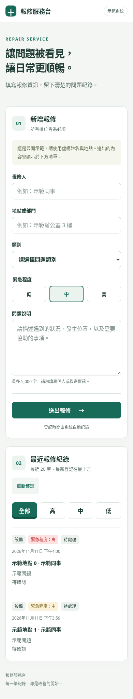
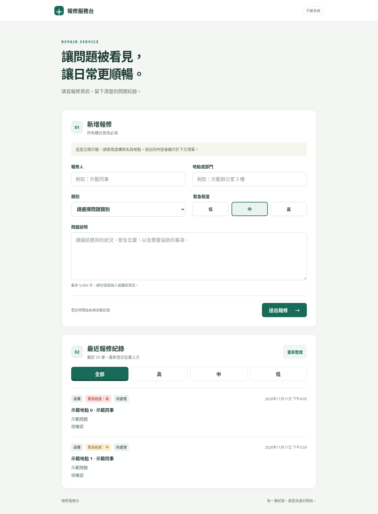

# 報修登記系統

純 HTML/CSS/JavaScript 的手機友善報修表單與最近 20 筆清單。首頁為根目錄的 `index.html`，不需建置；以 CDN 載入 supabase-js v2。

操作文件：[報修系統操作說明.docx](文件/報修系統操作說明.docx)

## 使用與部署

- 本機預覽：`python3 -m http.server 8000`，開啟 `http://localhost:8000`。
- GitHub Pages：設定來源為 **Deploy from a branch → main → / (root)**。
- 預期網址：<https://rex800418.github.io/gogoparis/>（若有自訂網域，以 Pages 設定為準）。
- `config.js` 只放專案網址與可公開的 publishable key；不可放 secret 或 service role key。
- Supabase 專案管理者須先執行並確認 `supabase/schema.sql` 的欄位授權與 RLS 已啟用。此網頁不會建立或修改資料表。
- 示範只用虛構姓名及地點，所有訪客都能讀取清單。

表單送出 `reporter_name`、`location`、`category`、`description`、`urgency`；不送出 `status`、`id` 或 `created_at`，由資料庫產生。清單依 `created_at` 降冪取 20 筆，登記時間顯示為台北時間。新增成功後清空表單並刷新清單；失敗時保留表單，清單可手動重試。

## 緊急程度篩選

清單上方提供「全部／高／中／低」按鈕，預設選取「全部」，選取的按鈕以深綠底與白字顯示。點選後只篩選網頁已載入的最近 20 筆紀錄，不會額外查詢資料庫，也不代表所有歷史報修。若該程度沒有資料，畫面會顯示提示；按「全部」可恢復原清單順序。

緊急程度「高」的標籤使用紅字與淡紅底。重新整理清單或送出新報修後，仍維持目前篩選；重新載入整個網頁則回到「全部」。本次未變更資料庫、欄位、權限或 `supabase/` 內任何檔案。

手機確認：在電腦切換到 PR 分支 `feat/urgency-list-filter`，執行 `python3 -m http.server 8000`；手機與電腦連同一個 Wi-Fi，開啟 `http://電腦的區域網路IP:8000`（電腦須允許區域網路存取此連接埠）。依序點「高／中／低／全部」，檢查選取樣式、顯示內容與空清單提示，並確認「高」標籤為紅色。PR 尚未合併時，正式 GitHub Pages 網站不會包含這次變更。

## 開發與檢查

Node.js 18 以上，先執行 `npm ci`。正式網站不依賴 Node.js。

- `npm run format`：以固定版本 Prettier 格式化。
- `npm run check`：JavaScript 語法及格式檢查。
- `npm test`：Playwright 瀏覽器測試；預設使用 `/usr/bin/chromium`，可用 `CHROMIUM_PATH` 指定其他 Chromium。

測試需要 curl 與 CDN 連線，使用真正的 supabase-js SDK 並模擬 REST API，驗證欄位、五欄新增內容、資料庫預設欄位未送出、成功/失敗/重試、前 20 筆清單、安全文字渲染及 320/390/1280px 版面。截圖輸出至 `docs/mobile.png`、`docs/desktop.png`。

本次雲端環境的網路政策拒絕 Supabase 與 GitHub Pages 網域，因此未實測遠端資料表的讀寫、預設值或 RLS，也未從此環境開啟正式站。模擬測試不代表正式資料庫權限已驗證。正式站驗證時，請確認公開用戶端能新增/讀取、不能修改/刪除，且新增後狀態為「待處理」、登記時間由資料庫產生。

## 畫面預覽（模擬資料）

